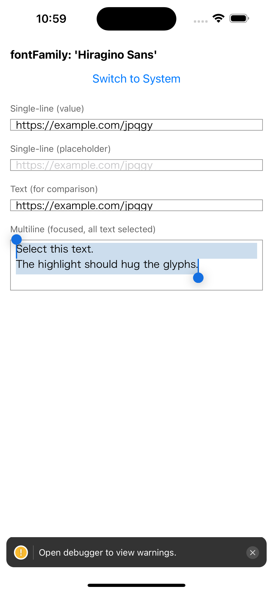
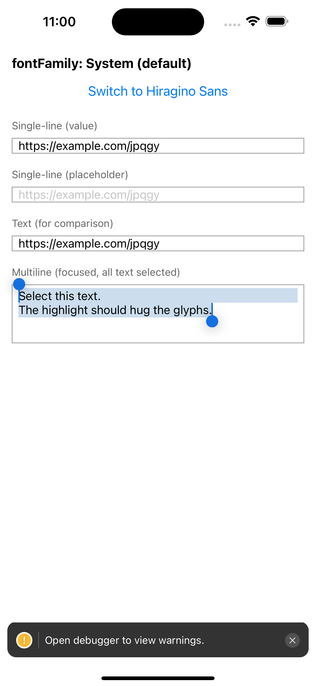

# Hiragino Sans clipping reproducer (React Native 0.88.1, iOS)

Reproducer for: on iOS, `Text` and `TextInput` with `fontFamily: 'Hiragino Sans'` clip descenders, and the selection highlight of a multiline `TextInput` extends below the glyphs.

Follow-up to https://github.com/react/react-native/issues/56123

## Run

```sh
npm install
cd ios && bundle install && bundle exec pod install && cd ..
npx react-native run-ios
```

## What to look at

All inputs use `fontFamily: 'Hiragino Sans'` and `fontSize: 16` (see `App.tsx`).

1. Single-line `TextInput` (value and placeholder): `j p q g y` are clipped at the bottom.
2. `Text`: clipped in the same way.
3. Multiline `TextInput` (focused, all text selected): the highlight extends well below the glyphs.

Tap **Switch to System** to compare with the default font. None of the problems occur.

| Hiragino Sans | System font |
|---|---|
|  |  |
